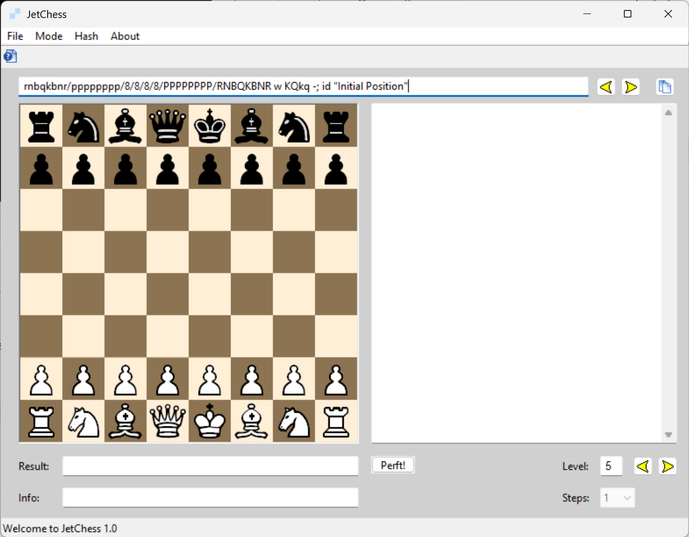

# JetChess

JetChess is a chess move-generator demo by Thomas Zipproth, originally released in 2006. It combines a desktop GUI with a library for **perft, distinct-position counting, mate search, and benchmarking**.

This version brings the original code to **64-bit Windows and Visual Studio 2026**, while retaining its search algorithms and familiar interface. Updates include larger hash tables, corrected FEN and en passant handling, SplitMix64-generated Zobrist keys, and hash-table prefetching.



## Modes

| Mode | What it calculates | Level |
| --- | --- | --- |
| **Move Path** | Perft: the number of legal move sequences ending at the selected depth. Different sequences leading to the same position are counted separately. | Half-moves (plies) |
| **Position** | The number of distinct positions reachable after exactly the selected number of half-moves. | Half-moves (plies) |
| **Mate** | Moves for White that force mate within the selected number of full moves. | Full moves |
| **Benchmark** | The original five-position mate-search benchmark. | Built-in depths |

Position identity includes the side to move, castling rights, and legally usable en passant rights. An en passant target that cannot legally be captured does not distinguish two otherwise identical positions.

Mate search is intended for chess problems. **White must be the side to move.** A reported mate may also be possible at a shorter depth; repeat the search at a lower level to check. JetChess is a move-generation and search demonstration rather than a playing engine with a positional evaluation.

## Using the GUI

1. Start `bin/x64/Release/JetChess.exe`.
2. Browse the included positions with the arrows beside the FEN field, or copy a FEN to the clipboard and click **Copy from Clipboard** to add it.
3. Select a mode from **Mode**, choose a **Level**, and set the hash size from **Hash**.
4. For Position mode, choose **Steps** if partitioning is needed.
5. Click the calculation button (**Perft!**, **Position!**, **Mate!**, or **Bench!**, depending on the mode). Results, progress, and elapsed time appear in the window.

Use **File → Stop** to interrupt a calculation. The **About** menu contains the built-in help and program information.

### FEN input

Both four-field FENs and complete six-field FENs are accepted. The historical `; id "..."` suffix is also supported. For example:

```text
rnbqkbnr/pppppppp/8/8/8/8/PPPPPPPP/RNBQKBNR w KQkq - 0 1
```

Invalid input leaves the previous position unchanged. Input, including optional annotations, is limited to **255 UTF-8 bytes**. Half-move and full-move counters are validated but are not used by the searches. The library does not provide a board-to-FEN exporter.

## Hash size and partitioning

The default hash size is **1 GB**. Available sizes are **1, 2, 4, 8, 16, and 32 GB**. The GUI uses “GB” for binary gigabytes: 1 GB corresponds to 1,024 MiB.

**Position mode needs an additional 25% of memory** for its intermediate-position cache. Selecting 1 GB therefore uses about 1.25 GB in total; selecting 32 GB uses about 40 GB. Allow enough available memory for the selected mode and size.

The end-position table must retain all distinct positions for the calculation. If it overflows, increase the hash size or use partitioning:

- **Steps** supports 1, 2, 4, 8, 16, or 32 passes.
- Each pass handles a different part of the end-position hash range.
- More passes trade computation time for greater effective table capacity.
- With 32 GB and 32 passes, the simulated end-position table capacity is 1,024 GB; that full size is not allocated in RAM.

If a requested allocation fails, JetChess attempts to fall back to 1 GB and reports the change. If that also fails, no calculation can start until memory is available.

## Building

### Requirements

- Windows with **Visual Studio 2026** and the **Desktop development with C++** workload, including the MSVC x64 tools (toolset **v145**) and a Windows SDK.
- **CMake 4.2 or newer**, available on `PATH`.
- PowerShell and Windows `tar`.
- Internet access for the initial wxWidgets download.

From the repository root:

```powershell
powershell -NoProfile -ExecutionPolicy Bypass -File tools\build.ps1
```

The script downloads the pinned **wxWidgets 3.2.12** source archive, verifies its SHA-256 checksum, and builds the required wxWidgets libraries followed by JetChess, in both Debug and Release configurations.

To build only Release:

```powershell
powershell -NoProfile -ExecutionPolicy Bypass -File tools\build.ps1 -Configuration Release
```

Once wxWidgets has been built, open **[JetChess.sln](JetChess.sln)** in Visual Studio and select **Release | x64** or **Debug | x64**. Set **JetChess** as the startup project if needed. Alternatively, rebuild the application and library without rebuilding wxWidgets:

```powershell
powershell -NoProfile -ExecutionPolicy Bypass -File tools\build.ps1 -SkipDependencies
```

The solution contains two projects:

| Project | Implementation | Output |
| --- | --- | --- |
| [JetChess](JetChess/JetChess.vcxproj) | C++17 GUI using wxWidgets | `JetChess.exe` |
| [MoveGen](MoveGen/MoveGen.vcxproj) | C17 static library | `MoveGen.lib` |

Outputs are written to `bin/x64/Release/` and `bin/x64/Debug/`. Generated build files live under `build/`; downloaded wxWidgets sources live under `third_party/`. These directories are excluded from Git.

wxWidgets is linked statically, so the executable does not need wxWidgets DLLs. Release builds use the dynamic MSVC runtime (`/MD`) and require the matching Microsoft Visual C++ x64 Redistributable on the target machine.

## Testing

Install **Python 3** on `PATH` and build the corresponding application/library configuration first. Then run:

```powershell
powershell -NoProfile -ExecutionPolicy Bypass -File tools\test.ps1
powershell -NoProfile -ExecutionPolicy Bypass -File tools\test.ps1 -Configuration Debug
```

The separate test build leaves the main solution at two projects. It checks:

- Perft results, including the initial position through depth 8 in Release.
- Distinct-position counts and partitioned calculations.
- Mate-search examples and the complete original benchmark in Release.
- FEN validation, en passant legality, and position-hash consistency.
- All six hash sizes, 64-bit index boundaries, allocation failures, and SplitMix64 test vectors.
- Cancellation, concurrent result reads, and restarting a calculation.

Reference data is stored in [tests/expected-results.json](tests/expected-results.json); input positions are in [tests/fixtures](tests/fixtures). Debug uses shorter perft searches and omits the benchmark.

Selected reference results for the initial position:

| Mode | Depth (plies) | Count |
| --- | ---: | ---: |
| Move Path | 7 | 3,195,901,860 |
| Move Path | 8 | 84,998,978,956 |
| Position | 6 | 9,417,681 |

Reports are written to `build/regression-results-Release.json` and `build/regression-results-Debug.json`. Normal tests need about 1.25 GB of available memory. Large-table boundary tests reserve virtual address space and commit only the pages needed for their probes.

## Library and source layout

```text
JetChess.sln       Visual Studio solution
JetChess.props     Shared build settings
JetChess/          GUI, dialogs, bitmaps, and embedded help
MoveGen/           Move generator, searches, hashing, and timing
tests/             Regression tools and reference positions
tools/             Build and test scripts
docs/              Screenshot used in this README
```

The C interface is declared in [MoveGen/mgen6.h](MoveGen/mgen6.h). Hash sizes passed to `hash_set()` are in MiB: `1024`, `2048`, `4096`, `8192`, `16384`, or `32768`; its return value is the active size. The historical console entry point remains disabled under `#if 0` in `MoveGen/mgen6.c`.

The library currently uses Windows timing and synchronization APIs. RTF resource loading and RichEdit display belong to the GUI. The original fixed-layout interface and single-worker search model are retained.

## Credits

- **Thomas Zipproth** — original JetChess and move generator.
- **[wxWidgets](https://wxwidgets.org/)** — GUI toolkit.
- **Hans Van Leemputten** — the wxHyperLink component; its author and wxWindows license notices are retained in [hyperlink.h](JetChess/hyperlink.h) and [hyperlink.cpp](JetChess/hyperlink.cpp).
